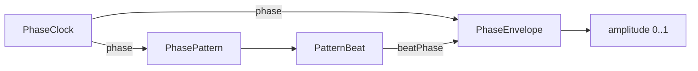

# KMLib Animation Cycles

Part of [KMLib Animation](../README.md).

Ambient repetition nobody triggered:
where a cycle stands,
what shape a turn of it takes,
and what rhythm it runs on.
Every type here is read rather than stepped,
so a surface that stops drawing comes back to a cycle that kept running
rather than to one that starts when it is looked at.
An animation timed from a moment the caller can name belongs to the
[parent package](../README.md#events-and-cycles) instead.

## Index

- [The register](#the-register)
- [Composing a read](#composing-a-read)
- [The envelope](#the-envelope)
- [Beat units and the two rhythms](#beat-units-and-the-two-rhythms)
- [Why a phase comes off real time](#why-a-phase-comes-off-real-time)
- [Spreading like emitters apart](#spreading-like-emitters-apart)

## The register

| Type | Answers |
| --- | --- |
| `PhaseClock` | where a repeating animation stands in its cycle at the instant it is asked |
| `PhaseEnvelope` | how high a value stands at a point in one turn of a cycle |
| `PhasePattern` | which stretches of a turn sound and which stay silent |
| `PatternBeat` | the element of a pattern a phase is in, and how far through it |

## Composing a read

The types compose into one amplitude,
either straight through an envelope for a plain repeating swell,
or through a rhythm first for one that stops and starts.

`PatternBeat` carries both whether the element sounds and how far through it the phase stands,
because either alone gets a consumer the wrong picture:
a progress without the state cannot tell the opening instant of a sound from a silence -
and with an instant rise those two read identically -
while a state without the progress cannot shape the sound it just reported.

## The envelope

`PhaseEnvelope` climbs over a leading share of the turn and falls over the rest of it.
The share carries what the animation reads as -
most of the turn spent climbing swells,
a sliver of it strikes and decays,
which is what an alarm or a ping looks like.
It is not the parent package's triggered `PulseEnvelope`;
[the two envelopes](../README.md#the-two-envelopes) tells them apart.

Both ends of the turn sit at rest,
so a phase that wraps carries the amplitude round with it and nothing jumps at the seam.
A share of 0 stands at the peak from the turn's first instant and decays across the whole of it;
a share of 1 climbs across the whole of it and never falls.

## Beat units and the two rhythms

A pattern's lengths are held in beat units rather than seconds,
so how fast it runs is the consumer's decision and how it is proportioned is the pattern's.
One unit is the rhythm's shortest sound;
every other length is a multiple of it,
which is what keeps a rhythm recognisable at any pace.
`resolvePeriodSeconds` converts a pace into the period to drive the clock at,
so no caller derives one from a length it would have to know.

| Rhythm | Proportions | Turn |
| --- | --- | --- |
| `STEADY_BEAT` | one sound, one silence as long as it | 2 units |
| `SOS` | three short, three long, three short; sounds parted by one, the group by seven | 30 units |

Elements alternate strictly,
opening on a sound and closing on a silence.
That is what lets a phase at the very end of a turn read as the opening instant of the next one,
so a wrapping phase crosses the seam without repeating or skipping an element -
and it is why the rhythms are a closed set rather than something a caller composes.

## Why a phase comes off real time

`PhaseClock` reads a monotonic source rather than simulation time,
because the two disagree exactly where an ambient animation has to carry on regardless.
A paused simulation stops advancing at all and a compressed one advances many seconds per frame,
so an animation phased off it would freeze in the first case and strobe in the second -
neither of which is anything the player did to the thing being animated.

Elapsed time is measured from the moment the clock was made,
so only differences are ever read
and a wall clock stepping backwards cannot send a phase back around.
A fresh clock starts its cycles over,
which is invisible in animation that repeats anyway.

## Spreading like emitters apart

Like things timed off one clock all peak on the same frame,
which reads as one thing happening rather than as many sources.
`resolvePhaseForSubject` moves each subject along its own fixed share of the turn,
derived from the subject's name through `kmlib.math.hashing.StableFractions`
rather than drawn or stored -
so a subject sits at the same point in every session and nothing has to be persisted for it to.
